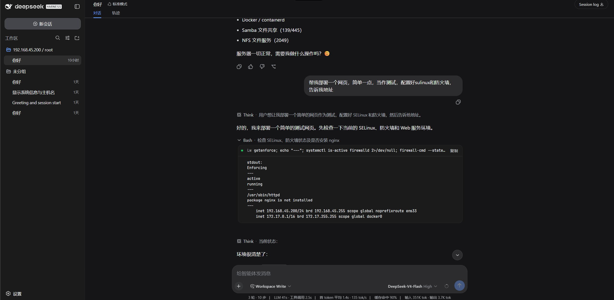

# dsh-cloud-workspaces

[](https://www.npmjs.com/package/dsh-cloud-workspaces)
[](https://www.npmjs.com/package/dsh-cloud-workspaces)
[](LICENSE)
[](#development)

**Remote Linux workspaces over SSH for [DeepSeek Harness](https://github.com/deepseek-ai/deepseek-harness) (DSH).**

> Requires DSH **>= 0.2.1-rc.5**. On 0.1.x, install `dsh-cloud-workspaces@0.3.0`.

Pick **Cloud (SSH)** in DSH's workspace picker, and the coding agent works directly on your Linux server: `bash`, `read`, `write`, `edit`, `glob`, `grep` — the entire built-in toolset — transparently execute over SSH. Files, search, editing and terminal all live on the remote box.

**Zero install on the server.** No vscode-server-style remote agent, no daemon, nothing to download — a standard OpenSSH server is all it takes.

<p align="center">
  
</p>

> 中文文档：[README.zh-CN.md](README.zh-CN.md)

---

## Why

DSH's agent runs on your local machine. When your code, data or production box lives on a remote Linux server, you either SSH in separately or fight with sync tools. Competing remote solutions ship a fat remote component (hundreds of MB) that must be downloaded to the server on first connect.

`dsh-cloud-workspaces` takes a different route: everything rides **standard SSH channels** (exec / SFTP / PTY via [ssh2](https://github.com/mscdex/ssh2)). The server needs nothing beyond what it already has.

## Features

### Cloud workspaces (the headline)

- **Dual-pane workspace picker** — a source rail (this machine / recent workspaces / SSH hosts) beside a directory pane with breadcrumbs, an editable path, empty/error states and inline folder creation; cloud workspaces are adopted by DSH's official workspace registry and show up in every session picker as `host / path`.
- **Transparent toolset redirect** — when a session's cwd falls under a cloud placeholder, the plugin registers same-named `bash` / `read` / `write` / `edit` / `glob` / `grep` / `read_image` tools **into that session's own agent scope**, so the agent keeps calling the tools it already knows while every call executes on the server. Local sessions are untouched — the shadowing is per session, and falls back to the official local tools the moment a session isn't a cloud one.
- **Shadow tools with official UI** — session-scoped remote `bash` / `read` / `write` / `edit` / `glob` / `grep` register in the agent's scope only, and implement the official `presentCall` / `presentResult` presenters, so chat rows render as real terminal / read / search cards — expandable, copyable, native.
- **Background jobs** — `run_in_background: true` on `bash` / `ssh_exec` starts the command as a first-class DSH job (`job_output` / `job_list` / `job_kill`, completion notices, jobs UI): installs, builds and test suites run on the server without ever hitting an exec timeout.
- **Port forwarding** — `ssh_tunnel start` maps `127.0.0.1:<port>` through the connection to a host reachable from the server (remote web previews, loopback-only databases, internal hosts). `stop` / `list` manage live forwards; they close when the connection drops.

### SSH settings card (in DSH Settings → SSH Connections)

- **Host manager** — display name, host, port, user; **password auth** (keyboard-interactive aware — works with PAM/Ubuntu servers that never offer the plain `password` method) or **private key** (path; ssh-agent fallback).
- **Connection test** — one-click probe with latency; saved credentials are reattached server-side (the browser only ever sees a redacted view).
- **Remote directory browser** — list, navigate, **create** and **delete** folders on the server; then **bind any directory as a cloud workspace** in one click.
- **ProxyJump** — jump-host chains, per-hop credentials.

### Agent tools

- `ssh_list` / `ssh_exec` / `ssh_ls` / `ssh_read` / `ssh_write` / `ssh_workspace` / `ssh_tunnel` — explicit remote access from any session, local or cloud. They take an optional `alias`; without one they follow the most recently activated connection.
- `ssh_workspace` — create a cloud workspace binding from chat.

### Connection layer

- ssh2 connection pooling with keepalive, broken-connection detection and transparent rebuild.
- Per-host latency-tested `test` endpoint reused by both the settings card and the picker.

### Security

- Host configuration lives in a private per-user file under `~/.dsh/` with owner-only permissions. **Passwords are never written to DSH's settings store** — they go only to that file, and any plaintext passwords left in settings by earlier versions are migrated out and stripped on startup. The settings card sees a redacted view and can never read a stored credential back.
- Remote sessions are scoped: shadow tools exist only inside sessions bound to a cloud workspace. Local workspaces are never affected.
- Remote file reads are capped; large files stream instead of buffering into memory.

## Install

Requires DSH (web profile), Node ≥ 22, and a reachable SSH server.

### From npm

```sh
dsh plugin --profile web add dsh-cloud-workspaces
```

### From source

```sh
git clone https://github.com/harryopo/dsh-cloud-workspaces.git
cd dsh-cloud-workspaces
pnpm install
pnpm build

# link into the DSH web profile (use a junction on Windows if the path has spaces)
dsh plugin --profile web add link:C:\path\to\dsh-cloud-workspaces
```

Restart `dsh web` after installing or rebuilding (the host half loads in the Node process).

## Usage

1. **Add a host** — Settings → SSH Connections → *Add host* → fill credentials → *Test* → *Save*.
2. **Bind a cloud workspace** — *Add workspace* → **Cloud (SSH)** tab → pick host → browse to your project → *Use this directory as workspace*.
3. **Open a session on that workspace** — the agent now runs entirely on the server. Ask it: `run pwd, then list the files here` and watch `bash` execute remotely.
4. Or drive it explicitly: `use ssh_exec to run docker ps on web-1`.

## Architecture

```
DSH host process (Node)
┌────────────────────────────────────────────────────────────┐
│  agent/created hook                                        │
│    └─ cloud-placeholder session?                           │
│         └─ register shadow bash/read/write/edit/           │
│            glob/grep/read_image into THAT agent's ctx      │
│                          │                                │
│  global ssh_* tools  ─────┤  (any session, explicit alias) │
│                          ▼                                │
│  SshRuntime (ctx.ssh) — single connection owner           │
│   └─ SshEngine (ssh2)                                      │
│      ├─ connection pool / keepalive / rebuild              │
│      ├─ exec · SFTP CRUD · PTY                             │
│      └─ ProxyJump hops                                     │
└──────────────┬─────────────────────────────────────────────┘
               │ SSH (exec / sftp / pty)  — nothing else
        ┌──────▼──────┐
        │ Linux server │  stock sshd. zero remote install.
        └─────────────┘

Browser (dsh web GUI): settings card + cloud-workspace picker
speak to the host over the official Typert remote bridge.
```

- **Host half** (`src/`, TypeScript): `SshEngine` + `SshRuntime`, shadow-tool registration for cloud sessions, the global `ssh_*` tools, Typert remote endpoints, background-job producer, settings schema.
- **Client half** (`client/`, plain ESM React via `createElement`): settings section + dual-pane workspace picker injected through official slots (`settings.section`, `workspace.*`). No JSX build step, `--dsw-*` design tokens only.

## Development

```sh
pnpm build        # tsc d.ts + tsdown bundle
pnpm typecheck    # tsc --noEmit
pnpm test         # vitest — 105 unit tests
node scripts/e2e-real-server.mjs   # 25 E2E checks over a real SSH server
```

### Runtime artifacts & dependencies

- `lib/` (host runtime + type declarations) is **committed on purpose**: the DSH STORE fixed-commit contract checks the repository as-is and does not run `prepare`/build. Run `pnpm build` and commit the refreshed `lib/` whenever source changes.
- Runtime dependencies are only **ssh2** (SSH transport) and **js-yaml** (one-time import of legacy settings). Everything `@deepseek-ai/*` is a peer resolved from the host profile, never bundled.
- On pnpm 10+/11 a fresh DSH profile may list `ssh2`'s install script as ignored (`ERR_PNPM_IGNORED_BUILDS`). Approve it in the DSH plugin manager's build-approval prompt (or `pnpm approve-builds`); the script only builds an optional native crypto acceleration and ssh2 falls back to pure JS without it.
- Network activity is outbound SSH to hosts the user configures. No telemetry, no third-party services. `ssh_tunnel` listeners bind `127.0.0.1` only.
- Secrets live in `~/.dsh/dsh-remote-ide.json` (0600 + Windows ACL); they are never written to settings, logs, tool output, or the browser.
- Failure boundaries: SSH/exec errors propagate as tool errors; background jobs report exit codes, cancellation, and a possible remote orphan when the transport drops; `glob`/`grep` fail loudly on timeout instead of returning an empty result.

## Roadmap

- [x] SSH engine: pooling, keepalive, broken-connection rebuild, ProxyJump
- [x] Cloud workspaces: dual-pane picker, placeholder dirs, official adoption
- [x] DSH 0.2 SDK migration (settings-namespace removal, push jobs producer)
- [x] Transparent toolset redirect (shadow tools registered per cloud session)
- [x] Shadow tools with official terminal/read cards
- [x] Background remote jobs (`ctx.jobs` producer): `run_in_background` + `job_output` / `job_list` / `job_kill`
- [x] Settings card: hosts, password/key auth (keyboard-interactive), test, remote dir browser
- [ ] Remote search tuning (ripgrep detection on the server)
- [x] SSH tunnel (local port forwarding)
- [x] npm first release (`dsh-cloud-workspaces@0.2.1`)

## Star History

<a href="https://www.star-history.com/?repos=harryopo%2Fdsh-cloud-workspaces&type=date&legend=top-left">
 <picture><source media="(prefers-color-scheme: dark)" srcset="https://api.star-history.com/chart?repos=harryopo/dsh-cloud-workspaces&type=date&theme=dark&legend=top-left" /><source media="(prefers-color-scheme: light)" srcset="https://api.star-history.com/chart?repos=harryopo/dsh-cloud-workspaces&type=date&legend=top-left" /></picture>
</a>

## Acknowledgements

- [DeepSeek Harness](https://github.com/deepseek-ai/deepseek-harness) — the harness and its official plugin SDK (`@deepseek-ai/dsh-*`); this plugin builds only on official npm SDK packages.
- [dsh-ssh](https://github.com/dsh-ssh/dsh-ssh) (Apache-2.0) — UI patterns for the settings card and workspace placeholder design.
- [ssh2](https://github.com/mscdex/ssh2) (MIT) — the SSH transport.

## License

[Apache-2.0](LICENSE)
