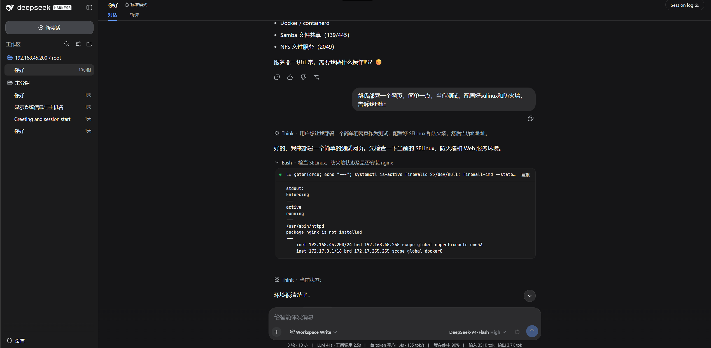

# dsh-cloud-workspaces

[](https://www.npmjs.com/package/dsh-cloud-workspaces)
[](https://www.npmjs.com/package/dsh-cloud-workspaces)
[](LICENSE)
[](#开发)

**[DeepSeek Harness](https://github.com/deepseek-ai/deepseek-harness)（DSH）的远程 Linux 工作区插件：把服务器目录直接变成工作区，全程走标准 SSH。**

> **兼容矩阵**
>
> | 插件 | DSH 版本 | 说明 |
> | --- | --- | --- |
> | **0.4.x** | **`^0.2.1-rc.5`**（仅 0.2.x） | settings 命名空间退场、推模式后台任务、双栏选择器、`ssh_tunnel` |
> | 0.3.x | `^0.1.1-rc.2`（0.1.x） | DSH 0.1.x 的最后一条线：远程后台任务 |
> | 0.2.x | `^0.1.1-rc.2`（0.1.x） | 0.2.1 曾上 npm；0.2.2 为安全加固版 |
>
> DSH 0.2.x 不能运行 0.3.x，DSH 0.1.x 不能运行 0.4.x。安装前先看 `dsh --version`。

在工作区选择器里选 **「云端 (SSH)」**，编码 Agent 就直接在你的 Linux 服务器上干活：`bash`、`read`、`write`、`edit`、`glob`、`grep` —— 内置工具全家桶 —— 全部经 SSH 透明执行。文件、搜索、编辑、终端，统统落在远程。

**服务器零安装。** 没有 vscode-server 式的远程组件、没有常驻进程、无需下载任何东西——一个标准 OpenSSH 服务端就是全部要求。

<p align="center">
</p>
<p align="center">
  
</p>

> English: [README.md](README.md)

---

## 为什么

DSH 的 Agent 跑在本地。当代码、数据或生产环境在远程 Linux 服务器上时，你只能另开 SSH 窗口，或折腾同步工具。同类远程方案首次连接要在服务器上下载几百 MB 的远程组件。`dsh-cloud-workspaces` 走另一条路：一切都走**标准 SSH 通道**（exec / SFTP / PTY，基于 [ssh2](https://github.com/mscdex/ssh2)）——服务器上什么都不用装。

## 功能

### 云端工作区（主打）

- **双栏工作台选择器** —— 左栏来源（本机 / 最近工作区 / SSH 主机），右栏目录浏览（可点面包屑、可编辑路径、空/错/加载三态、内联新建文件夹）；云端工作区经 DSH 官方工作区注册表收养，在选择器里显示为 `主机 / 路径`。
- **工具集透明重定向** —— 会话 cwd 落在云端占位目录下时，插件把同名的 `bash` / `read` / `write` / `edit` / `glob` / `grep` / `read_image` 注册进**该会话自己的 agent scope**——agent 照旧调用它早已熟悉的工具名，每次调用却落在远程执行。本地会话完全不受影响：遮蔽只作用于云端会话，会话一旦不是云端的，立刻回落到官方本地工具。
- **官方 UI 的遮蔽工具** —— 会话级远程 `bash` / `read` / `write` / `edit` / `glob` / `grep` 只注册进该会话的 agent scope，并实现官方 `presentCall` / `presentResult` 渲染器——聊天里的工具行渲染成真正的终端卡 / 阅读卡，可展开、可复制、原生观感。
- **后台任务** —— `bash` / `ssh_exec` 传 `run_in_background: true` 即把命令起成 DSH 一等公民 job（官方 `job_output` / `job_list` / `job_kill`、完成通知、任务 UI 全部现成）：安装、构建、测试套件在服务器上跑，永不撞执行超时。
- **端口转发** —— `ssh_tunnel start` 把 `127.0.0.1:<端口>` 经 SSH 映射到服务器可达的主机/端口（远端 Web 预览、只绑回环的数据库、内网服务）；`stop` / `list` 管理，连接断开自动关闭。

### SSH 设置卡片（DSH 设置 → SSH 连接）

- **主机管理** —— 显示名、主机、端口、用户；**密码认证**（支持 keyboard-interactive——PAM/Ubuntu 等只提供交互式认证的服务器也能连）或**私钥认证**（指定私钥文件路径）。
- **连接测试** —— 一键探测并显示延迟；已保存凭据在服务端补回（浏览器只见脱敏视图）。
- **远端目录浏览器** —— 浏览、**新建**、**删除**服务器文件夹；任意目录**一键绑定为云端工作区**。
- **ProxyJump** —— 跳板机链，逐跳凭据。

### Agent 工具

- `ssh_list` / `ssh_exec` / `ssh_ls` / `ssh_read` / `ssh_write` / `ssh_workspace` / `ssh_tunnel` —— 任意会话（本地或云端）里的显式远程操作。可选传 `alias`；不传则跟随最近激活的连接。
- `ssh_workspace` —— 在对话里创建云端工作区绑定。

### 连接层

- ssh2 连接池：keepalive、断线检测、透明重建。
- 按主机延迟测试的 `test` 端点，设置卡与选择器共用。

### 安全

- 主机配置存放在 `~/.dsh/` 下的用户私有文件（0600，Windows 上另加限制性 ACL）。**口令绝不写入 DSH 设置存储**——只落在这个文件里。旧版本遗留在 `settings.yaml` 的 `dsh-remote-ide-hosts` 段会被**只读导入一次、原样保留**：0.4.x 不会改写或删除它，请在设置卡确认主机已导入后**手动清理该段**（见 `docs/upgrade-to-0.2.md`）。设置卡只见脱敏视图，永远读不回凭据。
- 远程会话按作用域隔离：遮蔽工具只存在于绑定了云端工作区的会话中，本地工作区永不受影响。
- 远程读文件上限 2 MiB：超限文件只流式读取头部 2 MiB，返回 `truncated: true`，绝不整读进宿主内存；头部含 NUL 字节的二进制文件直接拒绝，不按文本渲染。

## 安装

要求：DSH（web profile）、Node ≥ 22、可连通的 SSH 服务器。

### 从 npm

```sh
dsh plugin --profile web add dsh-cloud-workspaces
```

### 从源码

```sh
git clone https://github.com/harryopo/dsh-cloud-workspaces.git
cd dsh-cloud-workspaces
pnpm install
pnpm build

# link 进 DSH web profile（Windows 路径含空格时用 junction）
dsh plugin --profile web add link:C:\path\to\dsh-cloud-workspaces
```

安装或重新构建后需重启 `dsh web`（host 半加载在 Node 进程里）。

## 使用

1. **添加主机** —— 设置 → SSH 连接 → 「+ 添加主机」→ 填凭据 → 「测试」→ 保存。
2. **绑定云端工作区** —— 「添加工作区」→ **云端 (SSH)** tab → 选主机 → 浏览到项目目录 → 「使用此目录作为工作区」。
3. **在该工作区上开会话** —— Agent 从此完全跑在服务器上。对它说「运行 pwd，再看看当前目录有什么」，看 `bash` 在远程执行。
4. 或者显式驱动：`用 ssh_exec 在 web-1 上跑 docker ps`。

## 架构

```
DSH host 进程 (Node)
┌────────────────────────────────────────────────────────────┐
│  agent/created 钩子                                        │
│    └─ 会话 cwd 是云端占位目录？                             │
│         └─ 把遮蔽 bash/read/write/edit/                     │
│            glob/grep/read_image 注册进该 agent 的 ctx      │
│                          │                                │
│  全局 ssh_* 工具  ───────┤  （任意会话，可显式指定 alias）  │
│                          ▼                                │
│  SshRuntime (ctx.ssh) —— 唯一连接所有者                    │
│   └─ SshEngine (ssh2)                                      │
│      ├─ 连接池 / keepalive / 断线重建                      │
│      ├─ exec · SFTP CRUD · PTY                             │
│      └─ ProxyJump 跳板                                     │
└──────────────┬─────────────────────────────────────────────┘
               │ SSH (exec / sftp / pty)  —— 仅此而已
        ┌──────▼──────┐
        │ Linux 服务器 │  原生 sshd。零远程安装。
        └─────────────┘

浏览器（dsh web GUI）：设置卡片 + 云端工作区选择器
经官方 Typert remote 桥与 host 通信。
```

- **Host 半**（`src/`，TypeScript）：`SshEngine` + `SshRuntime`、云端会话的遮蔽工具注册、全局 `ssh_*` 工具、Typert remote 端点、后台任务生产者。
- **Client 半**（`client/`，纯 ESM React `createElement`）：经官方插槽（`settings.section`、`workspace.*`）注入设置卡与双栏选择器。无 JSX 构建步骤，只用 `--dsw-*` 设计 token。

## 开发

```sh
pnpm build        # tsc d.ts + tsdown 产物
pnpm typecheck    # tsc --noEmit
pnpm test         # vitest —— 105 个单测
node scripts/e2e-real-server.mjs   # 25 个 E2E（真 SSH 服务器）
```

### 运行产物与依赖边界

- `lib/`（host 运行产物 + 类型声明）**随仓库提交**：DSH STORE 的固定 Commit 契约按仓库现状检查、不执行 `prepare`/构建。改源码后请 `pnpm build` 并一起提交 `lib/`。
- 运行时依赖只有 **ssh2**（SSH 传输）与 **js-yaml**（旧 settings 一次性导入）；`@deepseek-ai/*` 全部是宿主 profile 提供的 peer，不打进包。
- pnpm 10+/11 的全新 DSH profile 可能把 `ssh2` 的安装脚本列为未批准（`ERR_PNPM_IGNORED_BUILDS`）：在 DSH 插件管理器的构建审批里允许即可（或 `pnpm approve-builds`）。该脚本只构建可选的本地加密加速，不批准时 ssh2 会退回纯 JS 实现。
- 网络行为只有「连用户自己配置的 SSH 主机」；无遥测、无第三方服务。`ssh_tunnel` 只监听 `127.0.0.1`。
- 口令只存 `~/.dsh/dsh-remote-ide.json`（0600 + Windows ACL），不写 settings / 日志 / 工具输出 / 浏览器。
- 失败边界：SSH/命令错误如实抛给工具；后台任务报告退出码、取消结果与断连时可能的远端孤儿；`glob`/`grep` 超时直接报错而不是返回空结果。

## 路线图

- [x] SSH 引擎：连接池、keepalive、断线重建、ProxyJump
- [x] 云端工作区：双栏选择器、占位目录、官方收养
- [x] DSH 0.2 SDK 迁移（settings 命名空间移除、推模式后台任务）
- [x] 工具集透明重定向（遮蔽工具按云端会话注册）
- [x] 官方终端卡/阅读卡的遮蔽工具
- [x] 远程后台任务（`ctx.jobs` 生产者）：`run_in_background` + `job_output` / `job_list` / `job_kill`
- [x] 设置卡：主机、密码/密钥认证（keyboard-interactive）、连接测试、远端目录浏览器
- [ ] 远程搜索调优（服务器端 ripgrep 探测）
- [x] SSH 隧道（本地端口转发）
- [x] npm 首次发布（`dsh-cloud-workspaces@0.2.1`）

## 致谢

- [DeepSeek Harness](https://github.com/deepseek-ai/deepseek-harness) —— 宿主与官方插件 SDK（`@deepseek-ai/dsh-*`）；本插件仅基于官方 npm SDK 包构建。
- [dsh-ssh](https://github.com/dsh-ssh/dsh-ssh) (Apache-2.0) —— 设置卡 UI 与工作区占位设计参考。
- [ssh2](https://github.com/mscdex/ssh2) (MIT) —— SSH 传输层。

## 许可

[Apache-2.0](LICENSE)
